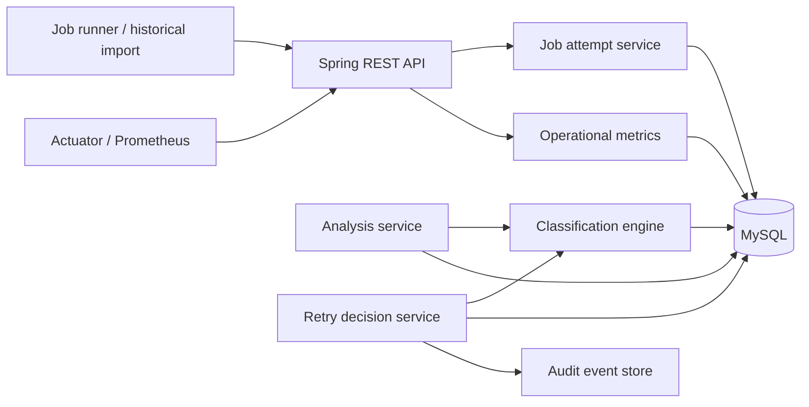

# Meridian Report Reliability Platform

## Project Overview

A small Spring Boot service for ingesting scheduled report-job attempts, applying operator-managed status classifications, detecting reports with no successful attempt, and recording bounded retry requests. Unknown statuses remain visible and are never retried implicitly.

**Retry integration boundary:** The platform durably records an accepted retry request in `retry_history`; it does not contain Meridian's report-generation runner. The runner/worker must consume accepted retry records and report its result before the request can be considered completed. This keeps the service safe to run locally and avoids claiming that a report was regenerated when no runner is connected.

## Architecture



## Technology Stack

Java 21, Spring Boot 3.3, Maven, Spring Data JPA, MySQL 8, Jakarta Validation, Spring Retry, Lombok, Micrometer/Actuator, JUnit 5, and H2 for integration tests.

## How to Run

Prerequisites: JDK 21, Maven 3.9+, Docker Engine and Docker Compose.

1. Start Docker Desktop with its Linux engine running.
2. From the project root in PowerShell, run `.\deploy.ps1`. This creates a Git-ignored `.env` with random local database credentials and starts the MySQL, application, and Adminer services.
3. Wait for MySQL and application health checks to pass.
4. Open `http://localhost:8080/actuator/health`. Adminer is available at `http://localhost:8081`.
5. Stop with `docker compose down`. Persisted local database data is retained in the `mysql-data` volume; `docker compose down --volumes` removes it.

The application runs on port 8080. Compose uses MySQL database `pocdb`, application user `pocuser`, and ports bound to loopback only. Database connection settings are configurable using `DB_URL`, `DB_USERNAME`, and `DB_PASSWORD`. `MAX_RETRIES` defaults to 3. Compose credentials are generated locally and stored in the ignored `.env`; configure managed secrets externally before any shared deployment.

To run the application without Compose, start a MySQL 8 database named `meridian`, then use:

```powershell
$env:DB_URL = "jdbc:mysql://localhost:3306/meridian?useSSL=false&allowPublicKeyRetrieval=true&serverTimezone=UTC"
$env:DB_USERNAME = "meridian"
$env:DB_PASSWORD = "your-local-password"
mvn spring-boot:run
```

## Database Setup

`src/main/resources/db/schema.sql` creates the required tables and indexes, and `data.sql` idempotently seeds the configurable `classification_rule` mappings and six example attempt records. Hibernate validates the schema at startup; it does not alter production tables. To reset local seed state, remove the Compose volume and restart.

In Compose, the MySQL image creates `pocdb` and `pocuser` on first initialization from `.env`. The application applies the schema and seed SQL on startup.

CSV and JSON examples are in `samples/`. Submit JSON records individually to `POST /api/jobs/attempts`; the API validates and persists each attempt. CSV ingestion is intentionally left to the upstream importer rather than adding a second parsing interface.

## API Examples

### Inspect undelivered reports

```powershell
curl.exe http://localhost:8080/api/jobs/failed
```

### Inspect unknown statuses and metrics

```powershell
curl.exe http://localhost:8080/api/jobs/unknown-statuses
curl.exe http://localhost:8080/api/metrics
curl.exe http://localhost:8080/actuator/prometheus
```

### Ingest an attempt

```powershell
curl.exe -X POST http://localhost:8080/api/jobs/attempts `
  -H "Content-Type: application/json" `
  -d "{\"tenantId\":\"TenantA\",\"reportName\":\"MonthlyReport\",\"scheduleTime\":\"2026-01-01T00:00:00\",\"attemptNumber\":1,\"status\":\"TIMEOUT\",\"errorCode\":\"GATEWAY_TIMEOUT\"}"
```

### Request a safe retry

```powershell
curl.exe -X POST http://localhost:8080/api/jobs/retry/1
```

Only statuses mapped to `RETRYABLE_FAILURE` can be requested. Each source attempt allows at most three requests. Every request creates retry history and an audit event in the same transaction. Spring Retry retries transient database failures up to three times with a short configurable backoff; it does not repeat report execution. Requests are persisted as `ACCEPTED` for the runner integration boundary; this API response alone does not mean the report was successfully delivered.

## Testing Instructions

```powershell
mvn test
```

Integration tests use an isolated in-memory H2 database and verify grouping, success detection, unknown handling, validation, metrics, retry classification, and the three-retry bound. SQL seeds are disabled for the test profile.

## Known Limitations

- A report-runner adapter/worker is not included; retry history is the durable handoff record and remains `ACCEPTED` until an operational consumer/result callback is integrated.
- Historical ingestion accepts JSON one attempt at a time; bulk file import and pagination are future work.
- Failed report detection is a point-in-time query over attempts already stored. A production scheduler should query eligible due schedules and raise alerts, with tenant-specific retention and authorization controls.
- API authentication/authorization is deployment-specific and not enabled in this local reference service. Do not expose it publicly without an identity provider and role-based access controls.
- Classification rules are seeded and managed in the database; a dedicated authenticated administration API is intentionally omitted.

## Future Improvements

Add a transactional outbox and runner consumer, durable result callbacks, retry backoff and idempotency keys, paginated bulk ingestion, alert routing, tenant authorization, Kafka event streaming, AI anomaly detection, predictive failure analysis, tenant-specific retry policies, and self-healing workflows.
