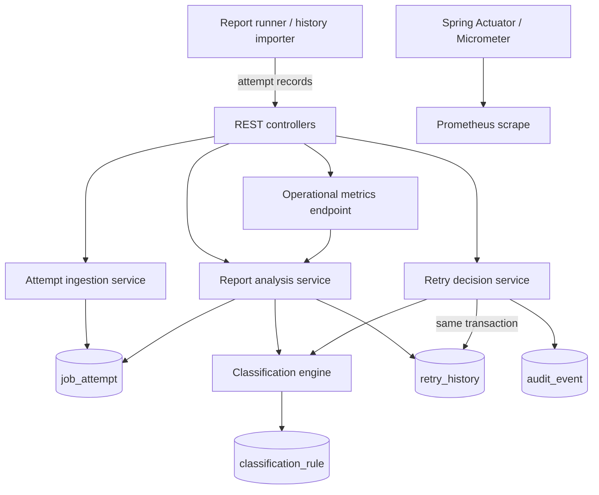

# Meridian Report Reliability Platform — Solution Design

## 1. Problem Restatement

Scheduled financial statement attempts are logged with inconsistent status values, and a report that never succeeds may remain unnoticed until a tenant complains. Meridian needs a service that classifies each attempt from editable rules, groups attempts by tenant/report/scheduled run, surfaces every run without a success, and safely records bounded retries for failures explicitly designated retryable. Unknown values must be visible without being guessed into a retry policy.

## 2. Assumptions

- One `job_attempt` row represents one observed runner execution. Detection groups by tenant, report, and calendar date of the schedule timestamp, as specified; attempt numbers are positive and unique for the exact scheduled run.
- `classification_rule.status` is the operator-controlled source of truth. Matching ignores case and surrounding input whitespace. Missing rules map to `UNKNOWN`.
- A successful attempt wins regardless of later failures. Without success, the highest-numbered attempt determines the run's displayed classification.
- Retry budget is three requests per source attempt. The API records a durable accepted request; a real report runner must consume it to execute work and report a result. No success is inferred from acceptance.
- Initial alert delivery, authentication, tenancy isolation, and retention policy are deployment integrations and require production-specific choices.

## 3. Architecture Diagram

## 4. Component Description

- **Controllers and DTOs:** expose validated JSON endpoints and avoid exposing persistence entities.
- **Attempt service/repository:** accepts individual historical/current observations; database uniqueness prevents duplicate attempt numbers for a scheduled run.
- **Classification engine:** performs case-insensitive lookups in the indexed rule table. It does not embed domain mappings in application code.
- **Analysis service:** groups stored records, identifies successes and computes latest-attempt classifications, unknown-status occurrence summaries, and aggregate counters.
- **Retry service:** serializes decisions for a source attempt with a row lock, checks classification and current retry count, then atomically writes retry history and an audit event.
- **Persistence/bootstrap:** explicit SQL DDL is validated by Hibernate, and idempotent seed SQL supplies example rules and attempts.
- **Observability:** JSON operational metrics at `/api/metrics`, standard health/info and Prometheus exposition via Actuator.

## 5. Failure Classification Strategy

Rules map a normalized status string to `SUCCESS`, `RETRYABLE_FAILURE`, or `NON_RETRYABLE_FAILURE`; absent rules yield `UNKNOWN`. Default seed rules cover successful aliases (`SUCCESS`, `COMPLETED`, `DELIVERED`), transient errors, permanent configuration/permission failures, and warning outcomes. Operations teams may update rules directly through controlled database migration/administration procedures. Since rule reads are live, an update affects subsequent API analysis without a restart. Unknown status reports include normalized values, counts, and attempt IDs for triage.

## 6. Retry Strategy

Retry is manual/API-triggered and restricted to rows currently classified as retryable. Under a pessimistic row lock, the service counts existing retries, rejects requests beyond the configurable limit (three by default), and atomically records `ACCEPTED` history plus audit. Spring Retry retries transient database failures around the request transaction, but never repeats report execution. This conservative design does not retry unknown or permanent errors, and prevents concurrent requests from overspending one attempt's retry budget. The report runner is an explicit integration boundary: accepted entries are durable handoff records, not proof of execution or delivery. A production deployment should use an outbox/worker with idempotency keys, backoff, result updates, dead-letter handling, and transactionally consistent result/audit updates. Success rate is based on retries explicitly marked `SUCCEEDED`; pending accepted records do not inflate it.

## 7. Trade-offs

- **SQL rule lookup:** simple and immediately editable, at the cost of a lookup per classification. A cache with explicit invalidation may be introduced after measuring read pressure.
- **Point-in-time analysis:** straightforward and auditable, but scans all attempt rows; pagination, streaming aggregation, and retention/partitioning are needed at scale.
- **No embedded runner:** avoids unsafe duplicate financial statement execution without Meridian's idempotency contract, but requires an adapter before automated re-generation occurs.
- **Database seed data:** makes local evaluation reproducible; production should manage schema and rules through reviewed migrations and operational governance.

## 8. Alternative Designs Considered

- Hardcoded enums for all statuses were rejected because runner values vary and classification must be operationally configurable.
- Blind automatic retries during report analysis were rejected due to duplicate side effects, unknown delivery state, and lack of job-runner idempotency.
- Kafka-first architecture was deferred because the required workflows fit a transactional relational store and no existing broker/consumer contract is provided.
- Treating `WARNING` as success was rejected: delivery semantics must be explicitly configured by operators rather than inferred.

## 9. Scaling Strategy

For higher data volumes, add cursor-paginated APIs and tenant/date filters, index schedule date and tenant, aggregate with database queries or incremental run-state projections, archive attempts by retention period, and partition large tables by time. Use a transactional outbox and horizontally scaled workers with per-run idempotency. Apply tenant-level authorization and quotas; separate ingestion/read workloads and use connection-pool limits and query plans to manage contention.

## 10. Observability Strategy

Expose request health through Actuator health probes; scrape standard JVM/HTTP metrics from `/actuator/prometheus`. The business metrics endpoint includes total attempts, successful and failed attempts, retryable failures, unknown statuses, explicitly completed retry success rate, and undelivered scheduled runs. Audit rows retain retry request history. A deployment should add alert thresholds for growing undelivered/unknown counts, dispatch age, retry exhaustion, and database health, with tenant-safe alert routing and correlation IDs.

## 11. Future Enhancements

- Kafka event streaming for decoupled attempt ingestion and retry dispatch.
- AI anomaly detection over failure patterns and status drift.
- Predictive failure analysis by tenant/report/dependency.
- Tenant-specific retry limits, backoff, schedules, and delivery SLOs.
- Self-healing workflows with idempotent runner integration, escalation, and verified customer notification.
- Authenticated rule administration, bulk ingestion, retention controls, and full audit of rule changes.
